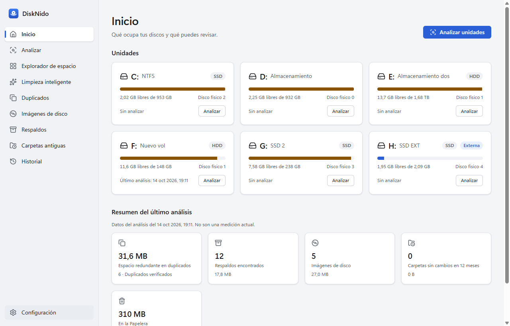
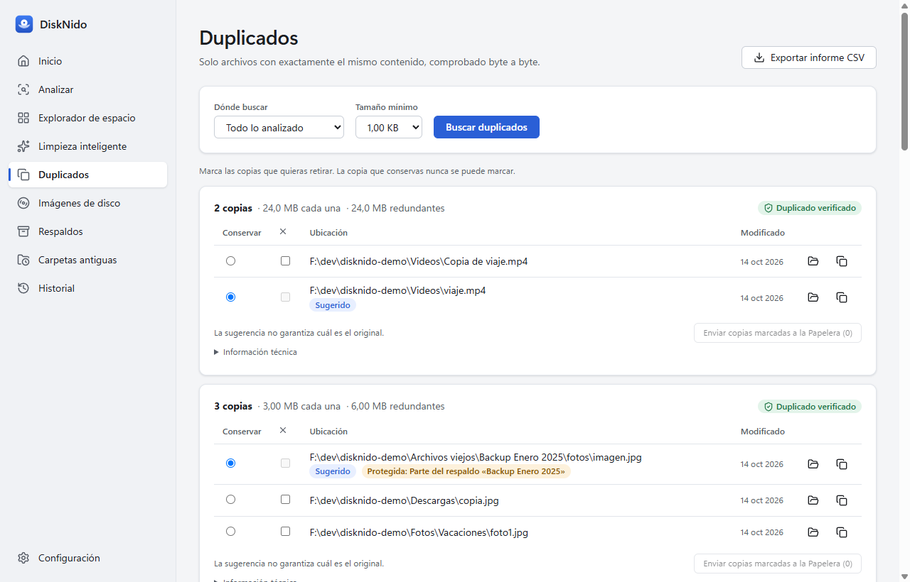
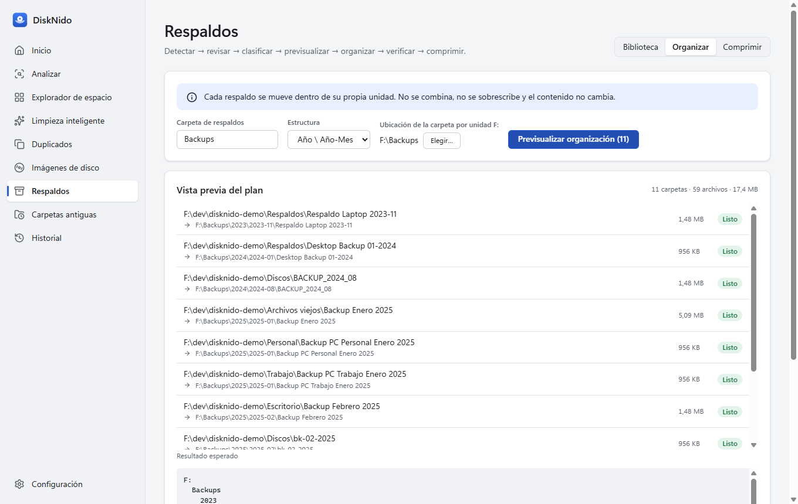
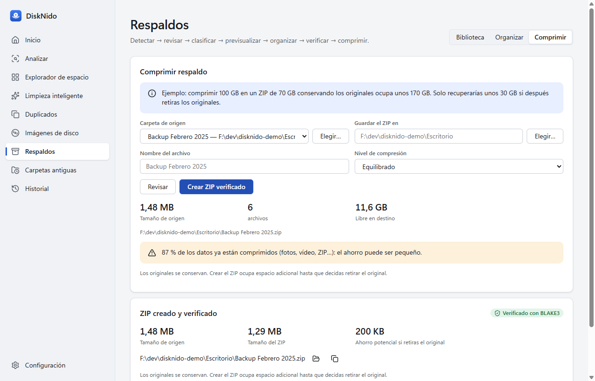
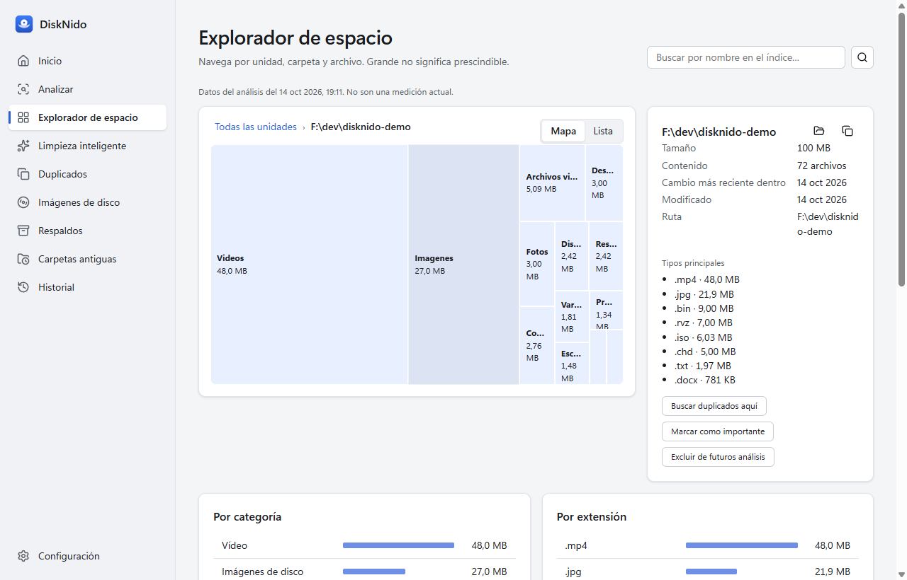
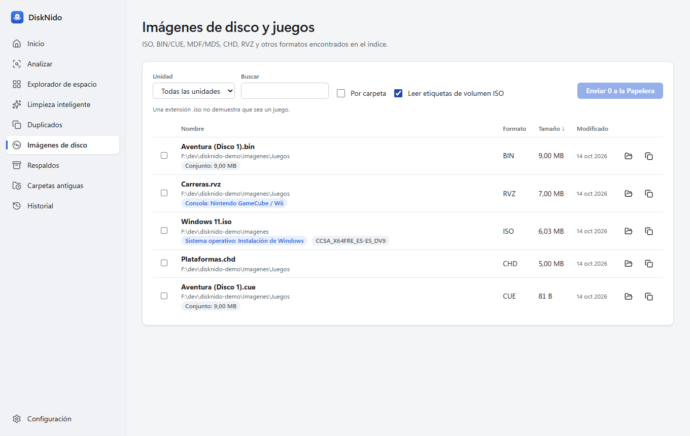
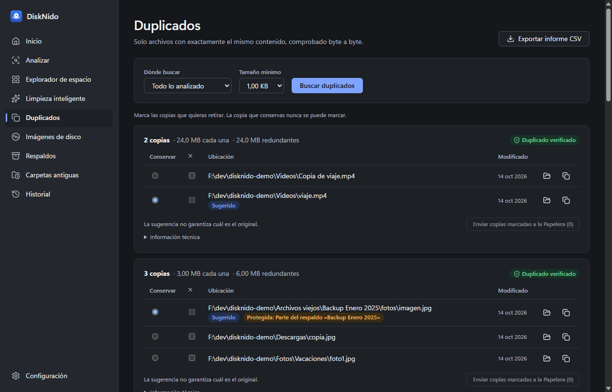

<p align="center"></p>

<h1 align="center">DiskNido</h1>

<p align="center"><b>Understand, clean and organise your Windows drives — safely.</b><br>
Free · open source (MIT) · local-only · no account · no ads · no telemetry</p>

<p align="center"><a href="README.es.md">Leer en español</a></p>



DiskNido is a Windows 10/11 desktop app that helps you recover space without
losing data. It shows what fills your drives, finds **exact** duplicates, disk
images and old backups, organises backups by drive, year and month, and
compresses them into **verified** ZIP archives.

> Status: **0.1.0 — first functional version.** Everything listed below is
> implemented and tested; see [Limitations](docs/LIMITATIONS.md).

## What it does

| | |
| --- | --- |
| **See what takes space** | Drives with capacity, SSD/HDD and physical disk; parallel read-only scan; treemap and list explorer; largest files/folders; by category and extension. |
| **Reasonable cleanup** | Documented rules over known locations only (user temp > 7 days, browser caches, crash dumps, error reports, old installers, large old downloads, Recycle Bin). Confidence levels and risks. Windows components are never touched (opens Storage Sense). |
| **Exact duplicates** | Size → hard-link identity → partial BLAKE3 → full BLAKE3 → **byte-by-byte**. Re-verified again right before a copy is recycled. Copies inside backups are protected. |
| **Disk images** | ISO, BIN/CUE, MDF/MDS, CHD, RVZ, WBFS, WUD/WUX, CSO, GDI… CUE/GDI sets, ISO 9660 volume labels, orphan warnings. |
| **Backups by drive, year and month** | Detects `Backup Enero 2025`, `BACKUP_2024_08`, `bk-02-2025`, `Respaldo Laptop 2023-11`…; flags ambiguous dates; dry-run plan with the resulting tree; atomic same-volume moves; verification; undo. |
| **Archive catalog** | Every verified ZIP keeps a searchable list of its contents and location; add existing ZIPs too. Accent- and case-insensitive search. |
| **Verified compression** | ZIP (Deflate/ZIP64) that is reopened and compared file by file with the originals (BLAKE3). Originals are always kept. Honest space accounting. |

| Duplicates | Backup plan | Verified ZIP |
| --- | --- | --- |
|  |  |  |

| Explorer | Disk images | Dark theme |
| --- | --- | --- |
|  |  |  |

Screenshots are real, taken from the app running on synthetic demo data
(`bench demo`).

## Safety principles

1. **Analysing never modifies files.**
2. **A recommendation is not an authorisation.** Every change needs your
   selection and a confirmation, and is validated again in Rust.
3. **Nothing is overwritten and nothing is deleted permanently.** Removal goes
   to the Recycle Bin; emptying it is separate and confirmed.
4. **Exact results.** Duplicates are byte-identical; ambiguous dates are not
   guessed; large or old does not mean disposable.
5. **Private.** Everything runs locally; nothing is sent anywhere.

Details: [SAFETY](docs/SAFETY.md) · [PRIVACY](docs/PRIVACY.md).

## Install

Requirements: Windows 10 (1809+) or 11, x64, WebView2 Runtime (included in
Windows 11). No developer tools needed.

Download `DiskNido-<version>-windows-x64-setup.exe` from
[Releases](https://github.com/emmanuelquintana/disknido/releases) when one is
published, verify it against `SHA256SUMS.txt`, and run it (per-user install,
no administrator rights). The installers are **not code-signed** yet, so
SmartScreen may warn: *More info → Run anyway*.

Until a release is published you can build it yourself (below).

## Getting started

1. **Analyze** → choose *Full*, select drives → *Start analysis*.
2. **Space explorer** to browse; **Duplicates**, **Disk images**, **Backups**
   and **Old folders** to review what was found.
3. **Backups → Organize** → *Preview organization* → confirm. Undo is in
   History.
4. **Backups → Compress** → *Review* → *Create verified ZIP*.

Full manual: [English](docs/USER_GUIDE.en.md) · [Español](docs/USER_GUIDE.es.md).

## FAQ

**Can DiskNido delete something by itself?** No. And it never deletes
permanently: it uses the Recycle Bin.
**Does it upload anything?** No network connections at all.
**Why is a duplicate copy not selectable?** It is protected (inside a backup,
system location, database, VM disk) or it is the copy you keep.
**Why did compression save little?** Photos, video and archives are already
compressed; DiskNido tells you before you start.

## Development

```powershell
pnpm install
pnpm tauri dev
cargo test -p disknido-core
pnpm typecheck; pnpm lint; pnpm test
pnpm tauri build          # installers in target/release/bundle
```

Stack: Rust (stable) · Tauri 2 · React 19 + TypeScript (strict) · Vite ·
SQLite (rusqlite, bundled) · BLAKE3 · zip · windows-sys.

* [Architecture](docs/ARCHITECTURE.md) · [Scanner](docs/SCANNER.md) ·
  [Duplicates](docs/DUPLICATES.md) · [Backups](docs/BACKUPS.md) ·
  [Compression](docs/COMPRESSION.md) · [Cleanup rules](docs/CLEANUP.md)
* [Development setup](docs/DEVELOPMENT.md) · [Testing](docs/TESTING.md) ·
  [Building](docs/BUILDING.md) · [Releasing](docs/RELEASING.md) ·
  [Performance](docs/PERFORMANCE.md) · [Data model](docs/DATA_MODEL.md) ·
  [Decisions](docs/DECISIONS.md) · [Troubleshooting](docs/TROUBLESHOOTING.md)

## Contributing

Contributions are welcome — see [CONTRIBUTING.md](CONTRIBUTING.md) and the
[Code of Conduct](CODE_OF_CONDUCT.md). Security issues: [SECURITY.md](SECURITY.md).

## Roadmap

See [ROADMAP.md](docs/ROADMAP.md): allocated-size accounting, several indexes,
cross-volume verified moves, ARM64, scheduled scans, signing and updates.

## Disclaimer

DiskNido is provided "as is", without warranty (see [LICENSE](LICENSE)). It is
designed to avoid data loss, but you are responsible for what you choose to
move, compress or recycle. Keep independent backups of important data.

## License

[MIT](LICENSE) © DiskNido contributors.
